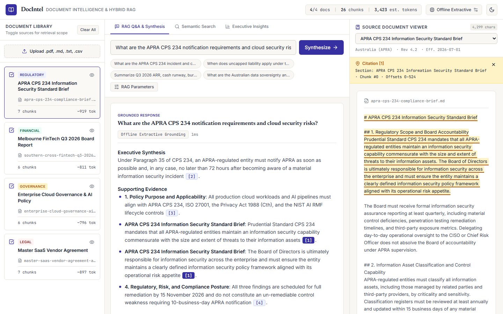
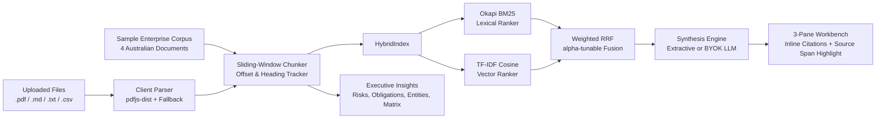

# DocIntel (`docintel-rag`)

An offline-first **Document Intelligence & Hybrid RAG Workbench** built with React, TypeScript, and Vite. DocIntel combines Okapi BM25 lexical scoring, L2-normalized TF-IDF cosine similarity, and weighted Reciprocal Rank Fusion (RRF) with verifiable character-offset citation binding and an inspectable 3-pane editorial interface.



## Architecture



## Hybrid Retrieval Scoring

Every query is tokenized, stopword-filtered, and suffix-normalized, then scored across all active document chunks using two complementary signals:

1. **Okapi BM25** (exact term frequency with length normalization, $k_1 = 1.5$, $b = 0.75$):
   $$\text{BM25}(q, d) = \sum_{t \in q} \text{IDF}(t) \cdot \frac{f(t, d)(k_1 + 1)}{f(t, d) + k_1 \left(1 - b + b \cdot \frac{|d|}{\text{avgdl}}\right)}$$

2. **Sublinear TF-IDF Cosine Similarity** (L2-normalized vector dot product in $[0, 1]$):
   $$\text{cos}(q, d) = \frac{\vec{v}_q \cdot \vec{v}_d}{\|\vec{v}_q\|_2 \|\vec{v}_d\|_2}, \quad w_{t,d} = (1 + \ln f(t, d)) \cdot \left(\ln\frac{N+1}{\text{df}(t)+1} + 1\right)$$

3. **Weighted Reciprocal Rank Fusion (RRF)** ($k = 60$, user-adjustable $\alpha \in [0, 1]$):
   $$\text{RRF}_\alpha(d) = (1 - \alpha)\frac{1}{k + \text{rank}_{\text{BM25}}(d)} + \alpha\frac{1}{k + \text{rank}_{\text{TFIDF}}(d)}$$

Every retrieved chunk preserves exact character offsets (`startOffset`, `endOffset`) into the original document so clicking any inline `[n]` citation or insight card scrolls directly to and highlights the exact source span.

## Key Capabilities

- **3-Pane Editorial Workbench**: Document Library (left), RAG Q&A / Semantic Search / Executive Insights (center), and Source Document Viewer with automatic span highlighting (right), plus a light/dark theme toggle.
- **Pre-loaded Australian Enterprise Corpus**: *APRA CPS 234 Information Security Standard Brief*, *Melbourne FinTech Q3 2026 Board Report*, *Enterprise Cloud Governance & AI Policy*, and *Master SaaS Vendor Agreement*, plus client-side upload support for `.pdf`, `.md`, `.txt`, and `.csv`.
- **Transparent Diagnostics & Live Tuning**: Inspect per-chunk BM25 scores, TF-IDF cosine similarities, RRF scores, and matched terms; adjust chunk size, overlap, top-$K$, and hybrid $\alpha$ in real time.
- **Optional BYOK LLM Provider**: Runs 100% offline with deterministic extractive grounding by default. Optionally connect any OpenAI-compatible Chat Completions endpoint via the Settings modal; API keys remain strictly in session memory and are never written to storage.
- **Automated Executive Insights**: Deterministic extraction of High/Medium/Low risk flags, compliance obligations with statutory deadlines, financial/SLA metrics, named regulators/standards, and a cross-document overlap matrix.

## Trade-offs & Limitations

- **TF-IDF vs. Neural Embeddings**: Dense neural embeddings (e.g., `text-embedding-3-small` or ONNX/WebGPU models) capture deeper paraphrase semantics than TF-IDF cosine similarity, but require either external API calls or ~50–100 MB browser model downloads. Using sublinear TF-IDF + BM25 + RRF keeps startup instant, deterministic, and zero-dependency offline while demonstrating genuine hybrid rank fusion.
- **Client-Side PDF Extraction**: `pdfjs-dist` extracts embedded text layers cleanly; scanned image-only PDFs without OCR text layers cannot be indexed in-browser.
- **In-Memory Index**: Re-chunking and indexing runs synchronously in memory, which is sub-10ms for tens of thousands of tokens but would require a Web Worker or backend vector store (e.g., `pgvector` / Qdrant) for multi-gigabyte corpora.

## Getting Started

```bash
pnpm install
pnpm run dev
```

### Verification Commands

```bash
pnpm run typecheck   # Strict TypeScript check (tsc --noEmit)
pnpm test            # Vitest unit test suite (19 tests across chunking, retrieval, synthesis, insights)
pnpm run build       # Production static bundle (base: './' for GitHub Pages)
```

## License

MIT — see [LICENSE](./LICENSE).
